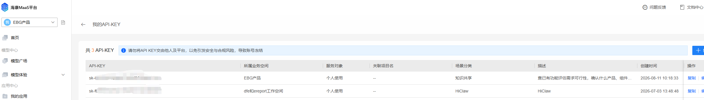
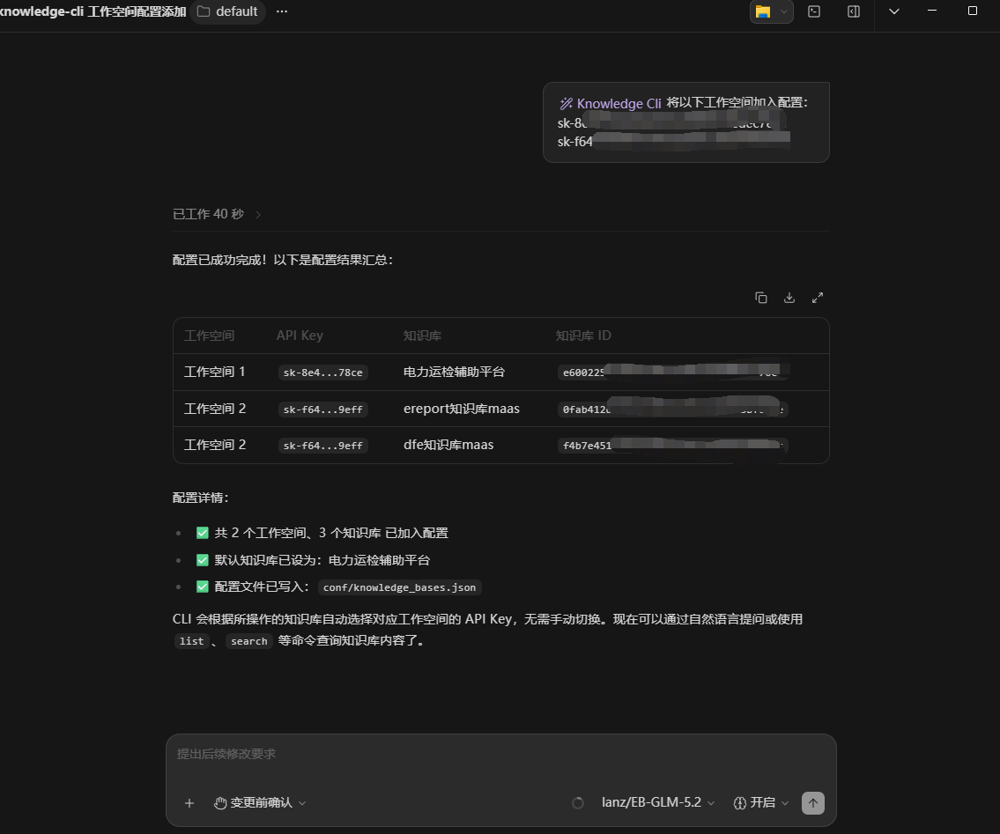
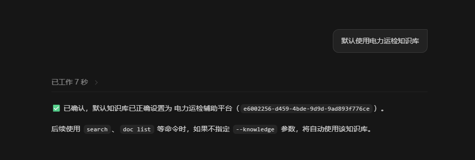

# knowledge-cli — 海康 MaaS 知识库 CLI

基于 Go 语言的海康 MaaS 知识库命令行工具，支持知识库管理、文档管理、分片管理、标签管理、分片检索和未命中问题上传。

## 作为 ZCode Skill 使用

本项目也可作为 [ZCode](https://zcode.com) 的 Skill 使用，通过自然语言搜索 MaaS 知识库。详见 [SKILL.md](SKILL.md)。

安装为 ZCode Skill 后，将本目录放置在 `~/.zcode/skills/knowledge-cli/` 下，ZCode 会自动识别 SKILL.md 中的能力定义，用户即可通过自然语言提问来搜索知识库。


## 自动配置
> **获取 API Key**：在 [MaaS 平台 API Key 页面](https://maas.hikvision.com.cn/maas/#/apiKey) 查看自己的业务空间 API Key。



支持同时复制多个，让大模型自动修改到配置中：



指定使用的知识库：

```bash
默认使用电力运检知识库
```



后续如果不指定其他知识库，将自动使用该知识库。


## 二次开发须知

### 从源码编译

- Go 1.21+（仅源码编译需要）
- 已配置 `conf/knowledge_bases.json`（含 `workspaces` 多工作空间配置），可参考 `conf/knowledge_bases.example.json` 模板
- 配置文件中至少一个工作空间的 `api-key` 已设置为有效的 MaaS API Key

```bash
git clone https://iris.hikvision.com.cn/ebg-ai-hub/knowledge-cli.git
cd knowledge-cli
go build -o knowledge-cli ./cmd/maas-cli/
cp conf/knowledge_bases.example.json conf/knowledge_bases.json
# 编辑 conf/knowledge_bases.json，填入真实的 api-key 和知识库信息
```

编辑 `conf/knowledge_bases.json`：

> **获取 API Key**：在 [MaaS 平台 API Key 页面](https://maas.hikvision.com.cn/maas/#/apiKey) 查看自己的业务空间 API Key。

```json
{
  "defaultKnowledgeName": "默认知识库名称",
  "defaultKnowledgeId": "knowledge-base-uuid",
  "workspaces": [
    {
      "api-key": "sk-xxx1",
      "knowledgeBases": [
        { "name": "知识库A", "id": "uuid-a" },
        { "name": "知识库B", "id": "uuid-b" }
      ]
    },
    {
      "api-key": "sk-xxx2",
      "knowledgeBases": [
        { "name": "知识库C", "id": "uuid-c" }
      ]
    }
  ]
}
```

- `defaultKnowledgeName` / `defaultKnowledgeId`：默认知识库，以 `defaultKnowledgeId` 为准，当未指定 `--knowledge` 或 `--knowledge-id` 时使用
- `workspaces`：工作空间列表，每个工作空间有独立的 `api-key` 和 `knowledgeBases`，CLI 会根据知识库自动选择对应工作空间的 API Key
- `knowledgeBases`：知识库列表，通过 `--knowledge <名称>` 自动查找对应 ID

> **提示**：如果已知 API Key 但不确定知识库 ID，可运行 `knowledge-cli init --api-keys "sk-xxx1,sk-xxx2"` 自动拉取多个工作空间的知识库并更新配置文件。

### 全局参数

以下参数适用于所有命令：

| 参数 | 默认值 | 说明 |
|------|--------|------|
| `--api-key` | （从配置文件读取） | MaaS 平台 API Key |
| `--base-url` | `https://maas.hikvision.com.cn` | MaaS 平台地址 |
| `--timeout` | `30` | 请求超时（秒） |
| `--insecure` | `false` | 跳过 TLS 证书验证 |
| `--config` | `conf/knowledge_bases.json` | 配置文件路径 |

## 能力边界

| 命令 | 能力 |
|------|------|
| `knowledge-cli init` | 拉取多工作空间知识库，合并更新配置文件 |
| `knowledge-cli switch` | 切换默认知识库 |
| `knowledge-cli list` | 列出知识库，支持名称模糊搜索 |
| `knowledge-cli get` | 根据 ID 获取知识库详情 |
| `knowledge-cli create` | 创建知识库，可选启用知识图谱 |
| `knowledge-cli update` | 更新知识库名称、描述、图谱配置 |
| `knowledge-cli delete` | 删除知识库 |
| `knowledge-cli graph create` | 批量创建知识图谱（灰度中） |
| `knowledge-cli graph delete` | 批量删除知识图谱（灰度中） |
| `knowledge-cli doc list` | 列出知识库中的文档，支持文档名搜索 |
| `knowledge-cli doc get` | 根据 ID 获取文档详情 |
| `knowledge-cli doc chunks` | 查看文档分片列表，支持关键字搜索 |
| `knowledge-cli doc upload` | 上传文档文件到 MaaS 平台 |
| `knowledge-cli doc import` | 将已上传文档导入知识库 |
| `knowledge-cli doc create` | 创建空白文档（.custom） |
| `knowledge-cli doc enable` | 启用文档（支持批量） |
| `knowledge-cli doc disable` | 禁用文档（支持批量） |
| `knowledge-cli doc delete` | 删除文档 |
| `knowledge-cli doc view` | 获取文档预览链接 |
| `knowledge-cli doc download` | 获取文档下载链接 |
| `knowledge-cli doc graph-restart` | 重启文档图谱创建（灰度中） |
| `knowledge-cli chunk get` | 获取分片详情 |
| `knowledge-cli chunk add` | 新增分片 |
| `knowledge-cli chunk add-auto` | 自动查找/创建文档并新增分片 |
| `knowledge-cli chunk update` | 更新分片内容/状态 |
| `knowledge-cli chunk delete` | 批量删除分片 |
| `knowledge-cli chunk relate` | 获取关联分片（上下文） |
| `knowledge-cli chunk question add` | 新增关联问题 |
| `knowledge-cli chunk question update` | 更新关联问题 |
| `knowledge-cli chunk question delete` | 删除关联问题 |
| `knowledge-cli chunk image update` | 更新关联图片描述 |
| `knowledge-cli chunk image delete` | 删除关联图片 |
| `knowledge-cli label add` | 新增标签 |
| `knowledge-cli label list` | 分页查询标签 |
| `knowledge-cli label update` | 更新标签（新增/删除标签值） |
| `knowledge-cli label delete` | 删除标签 |
| `knowledge-cli search` | 分片检索：语义/全文/混合，支持 rerank |
| `knowledge-cli upload-unanswered` | 上传审核后的未命中问题到知识库 |

## 命令参考

### 初始化配置

```bash
# 拉取多个工作空间的知识库并合并更新配置文件
knowledge-cli init --api-keys "sk-xxx1,sk-xxx2"

# 单工作空间拉取（使用 --api-key）
knowledge-cli init --api-key "sk-xxx1"

# 从已有配置文件中的 API Key 重新拉取
knowledge-cli init

# 指定拉取数量
knowledge-cli init --api-keys "sk-xxx1,sk-xxx2" --page-size 200
```

### 切换默认知识库

```bash
# 切换默认知识库（同时更新 defaultKnowledgeId 和 defaultKnowledgeName）
knowledge-cli switch --knowledge "电力运检辅助平台"

# 查看当前默认和所有可用知识库
knowledge-cli switch
```

### 知识库管理

```bash
# 列出所有知识库
knowledge-cli list

# 按名称模糊搜索
knowledge-cli list --name "电力"

# 查看知识库详情
knowledge-cli get --id <knowledgeId>

# 创建知识库
knowledge-cli create --name "测试知识库" --detail "用于测试"

# 创建知识库并启用知识图谱（灰度中）
knowledge-cli create --name "图谱知识库" --detail "带图谱" --graph --graph-method 1 --graph-entity-types "人物,组织"

# 更新知识库
knowledge-cli update --id <knowledgeId> --name "新名称" --detail "新描述"

# 删除知识库（⚠️ 不可恢复）
knowledge-cli delete --id <knowledgeId>

# 批量创建知识图谱（灰度中）
knowledge-cli graph create --ids "<id1>,<id2>"

# 批量删除知识图谱（灰度中）
knowledge-cli graph delete --ids "<id1>,<id2>"
```

### 文档管理

```bash
# 列出文档（使用默认知识库）
knowledge-cli doc list

# 按文档名搜索
knowledge-cli doc list --content "用户手册"

# 指定知识库
knowledge-cli doc list --knowledge "电力运检辅助平台"

# 查看文档详情
knowledge-cli doc get --id <docId>

# 查看文档分片
knowledge-cli doc chunks --id <docId> --page-size 10

# 在分片中搜索关键字
knowledge-cli doc chunks --id <docId> --keyword "配置"

# 上传文档（一步上传+导入，--files 支持多个文件，逗号分隔或重复传参）
knowledge-cli doc upload --files "D:\docs\产品介绍.pdf" --knowledge "电力运检辅助平台"

# 导入已上传文档
knowledge-cli doc import --knowledge "电力运检辅助平台" --doc-name "产品介绍.pdf" --storage-id "<storageId>" --doc-hash "<docHash>"

# 创建空白文档（.custom）
knowledge-cli doc create --knowledge "电力运检辅助平台" --doc-name "自定义内容.custom"

# 创建文档并启用图片解析
knowledge-cli doc create --knowledge "电力运检辅助平台" --doc-name "图文文档.custom" --image-enable --image-parse-type 3

# 启用文档（支持批量，逗号分隔）
knowledge-cli doc enable --id "<docId1>,<docId2>"

# 禁用文档
knowledge-cli doc disable --id "<docId1>,<docId2>"

# 删除文档
knowledge-cli doc delete --id <docId>

# 获取文档预览链接
knowledge-cli doc view --id <docId>

# 获取文档下载链接
knowledge-cli doc download --id <docId>

# 重启文档图谱创建（灰度中）
knowledge-cli doc graph-restart --doc-ids "<docId1>,<docId2>"
```

### 分片管理

```bash
# 获取分片详情
knowledge-cli chunk get --doc-id <docId> --id <chunkId>

# 新增分片
knowledge-cli chunk add --knowledge "电力运检辅助平台" --doc-id <docId> --content "分片内容" --title "分片标题"

# 自动查找/创建 custom-questions.md 文档并新增分片（无需 --doc-id）
knowledge-cli chunk add-auto --knowledge "电力运检辅助平台" --content "Q&A 内容" --title "问题标题"

# 更新分片内容/状态
knowledge-cli chunk update --knowledge "电力运检辅助平台" --doc-id <docId> --id <chunkId> --content "新内容"
knowledge-cli chunk update --knowledge "电力运检辅助平台" --doc-id <docId> --id <chunkId> --status 2

# 批量删除分片
knowledge-cli chunk delete --knowledge "电力运检辅助平台" --doc-id <docId> --chunk-ids "<chunkId1>,<chunkId2>"

# 获取关联分片（上下文）
knowledge-cli chunk relate --knowledge "电力运检辅助平台" --doc-id <docId> --id <chunkId> --previous 2 --next 2

# 关联问题管理
knowledge-cli chunk question add --doc-id <docId> --id <chunkId> --question-content "问题内容"
knowledge-cli chunk question update --doc-id <docId> --id <chunkId> --question-id <qId> --question-content "新问题"
knowledge-cli chunk question delete --doc-id <docId> --id <chunkId> --question-id <qId>

# 关联图片管理
knowledge-cli chunk image update --doc-id <docId> --id <chunkId> --image-id <imgId> --image-desc "图片描述"
knowledge-cli chunk image delete --doc-id <docId> --id <chunkId> --image-id <imgId>
```

### 标签管理

```bash
# 新增标签
knowledge-cli label add --name "产品类型" --values "摄像头,录像机,门禁"

# 查询标签列表
knowledge-cli label list
knowledge-cli label list --keyword "产品"
knowledge-cli label list --page-size 20

# 更新标签（新增/删除标签值；后端不支持改名，因此没有 --name 参数）
knowledge-cli label update --label-id <labelId> --add-values "新值1,新值2"
knowledge-cli label update --label-id <labelId> --delete-values "<valueId1>:<labelValue1>,<valueId2>:<labelValue2>"

# 删除标签（⚠️ 不可恢复）
knowledge-cli label delete --label-id <labelId>
```

### 分片检索

```bash
# 基础搜索
knowledge-cli search --query "巡检任务配置"

# 高精度搜索（提高相似度阈值）
knowledge-cli search --query "告警审核" --similarity 0.5

# 全文检索
knowledge-cli search --query "设备台账" --strategy 2

# 指定 rerank 模型
knowledge-cli search --query "智能巡视" --rerank-model "bge-reranker-v2-m3"

# 跨知识库搜索
knowledge-cli search --knowledge-id "<id1>,<id2>" --query "安全管理"

# 调整未命中阈值（默认 0.9，低于此值记录为未命中问题）
knowledge-cli search --query "XXX功能" --unanswered-threshold 0.85
```

**检索参数说明**：

| 参数 | 默认值 | 说明 |
|------|--------|------|
| `--query` | （必填） | 搜索关键词 |
| `--top-k` | `10` | 返回结果数 |
| `--similarity` | `0.6` | 相似度阈值，仅返回高于此分数的分片 |
| `--strategy` | `3` | 检索策略：1=语义检索，2=全文检索，3=混合检索 |
| `--rerank` | `true` | 是否启用 rerank 模型 |
| `--rerank-model` | （默认） | rerank 模型：bge-reranker-base, bge-reranker-v2-m3, bge-reranker-large, Qwen3-Reranker-0.6B |
| `--unanswered-threshold` | `0.9` | 未命中检测阈值，所有结果低于此值时记录问题到 cache |

### 上传未命中问题

搜索未命中时，问题会自动记录到 `cache/unanswered-questions-YYYYMMDD.md`。人工审核补充答案后，可批量上传到知识库：

```bash
# 预览待上传内容（不实际上传）
knowledge-cli upload-unanswered --knowledge "电力运检辅助平台" --dry-run

# 上传审核后的未命中问题
knowledge-cli upload-unanswered --knowledge "电力运检辅助平台"

# 指定 cache 目录
knowledge-cli upload-unanswered --knowledge "电力运检辅助平台" --cache-dir "./cache"
```

上传逻辑：
- `.custom` 文件：内容作为单个分片上传，文件名（去掉 `.custom`）作为标题
- `unanswered-questions-*.md` 文件：解析每个问题块，仅上传已填写答案的块（已审核），未审核的保留在文件中
- 上传成功后自动删除本地文件（`.md` 文件中未审核的块会保留并重写）

## 安全边界

- **只读操作**：`list`、`get`、`doc list`、`doc get`、`doc chunks`、`doc view`、`doc download`、`chunk get`、`chunk relate`、`label list`、`search`、`switch`（无参数时）
- **写操作**（执行前需确认）：`init`、`switch`（带 `--knowledge` 时）、`create`、`update`、`delete`、`graph create/delete`、`doc upload`、`doc import`、`doc create`、`doc enable/disable`、`doc delete`、`doc graph-restart`、`chunk add/add-auto`、`chunk update`、`chunk delete`、`chunk question add/update/delete`、`chunk image update/delete`、`label add/update/delete`、`upload-unanswered`
- **危险操作**（⚠️ 不可恢复）：`delete`（知识库）、`doc delete`、`chunk delete`、`label delete`
- API Key 优先从配置文件读取，不通过命令行传递
- 不在回答中输出完整的 API Key
- 配置文件 `conf/knowledge_bases.json` 已通过 `.gitignore` 排除，不会提交到仓库


